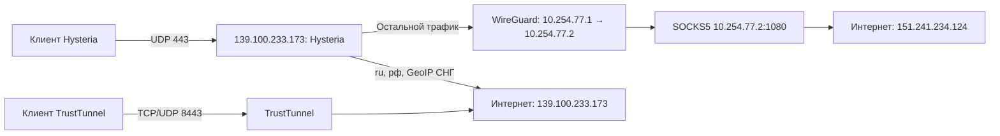

# Архитектура и маршрутизация

## Узлы

| Роль | Адрес / имя | ОС / интерфейс | Службы |
|---|---|---|---|
| Входной сервер, Selectel | `139.100.233.173`, hostname `valeria` | Ubuntu x86_64 / `eth0` | `h-ui`, Docker `trusttunnel-web`, `wg-quick@wg-private` |
| Выходной сервер | `onixus.ru`, `151.241.234.124` | Ubuntu / `ens1` | `hysteria-exit`, `wg-quick@wg-private` |
| Linux-клиент | `192.168.68.120`, пользователь `onixus` | Arch Linux / `enp6s0` | `sing-box`, интерфейс `hy-tun` |

Имена интерфейсов относятся к существующим узлам. На новой машине определите их через `ip route get 1.1.1.1`.

## Порядок правил Hysteria

1. TCP `10.254.77.1:18082` → локальная панель TrustTunnel.
2. TCP `10.254.77.1:8081` → локальная H UI.
3. Остальные приватные назначения отклоняются.
4. Суффиксы `.ru`, `.xn--p1ai` (`.рф`) → прямой выход.
5. GeoIP `RU BY KZ KG TJ UZ AM AZ MD TM` → прямой выход.
6. Всё остальное → SOCKS5 на onixus.ru.

Список стран: Россия, Беларусь, Казахстан, Кыргызстан, Таджикистан, Узбекистан, Армения, Азербайджан, Молдова, Туркменистан. Украина и Грузия в исключения не входят. База GeoIP может ошибаться или устаревать; это не гарантия физического размещения сайта.

Правила выполняются сверху вниз. Для доменных исключений серверу нужно имя назначения: SOCKS5h передаёт его, а sniffing HTTP/TLS помогает восстановить его из части IP-соединений. ECH, нестандартные протоколы и IP-only приложения могут не раскрывать имя; тогда остаются IP/GeoIP-правила.

На `.120` `.ru`/`.рф` обходят VPN **ещё на клиенте**, поэтому выход может быть адресом домашнего провайдера. Это отличается от прямого выхода серверного исключения. DNS FakeIP и TUN обеспечивают сопоставление имён в sing-box.

WireGuard передаёт только приватные адреса двух серверов, MTU 1380, keepalive 25 секунд. В нём нет `AllowedIPs = 0.0.0.0/0`. Default route серверов не меняется, отдельный NAT для WG не нужен: наружу соединения открывает SOCKS5.

## Порты

| Узел | Порт | Доступ |
|---|---|---|
| Вход | TCP 22 | SSH по ключам |
| Вход | UDP 443 | Hysteria + salamander |
| Оба сервера | UDP 51830 | только противоположный публичный IP |
| Вход | TCP 8081 | H UI, публично запрещён UFW |
| Вход | TCP 127.0.0.1:9999 | внутренняя статистика Hysteria |
| Вход | TCP 127.0.0.1:18082 | панель TrustTunnel, Docker publish только loopback |
| Вход | TCP+UDP 8443 | TrustTunnel |
| Выход | TCP 10.254.77.2:1080 | SOCKS5 с паролем, только WG-партнёр |
| Выход | UDP по wg-private | SOCKS5 UDP relay, только 10.254.77.1 → 10.254.77.2 |
| Клиент | TCP 127.0.0.1:10808/10809 | локальные прокси sing-box |

Для обычного трафика Hysteria нет автоматического прямого fallback при отказе onixus.ru. Но клиентская конфигурация не является гарантированным kill switch: после остановки TUN интернет может идти напрямую. TrustTunnel-профиль также имеет `killswitch_enabled = false`.

## Резервный выход

Добавлен узел `185.199.158.8` с отдельным WG `10.254.78.1 ↔ 10.254.78.2`, UDP 51831. По умолчанию выбран onixus.ru; ручное переключение меняет только основной catch-all Hysteria. См. [инструкцию переключения](reserve-exit.md).
