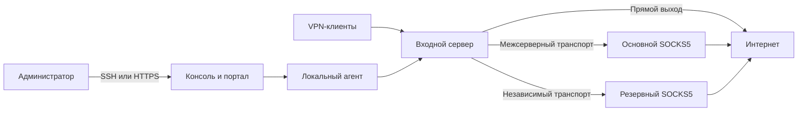

# Архитектура и маршрутизация

## Роли узлов

| Роль | Пример адреса | Компоненты |
|---|---|---|
| Входной сервер | `vpn.example.com`, `192.0.2.10` | Портал, консоль, агент, выбранные VPN-протоколы |
| Основной выход | `exit.example.com`, `198.51.100.10` | Межсерверный транспорт и SOCKS5 |
| Резервный выход | `reserve.example.com`, `203.0.113.10` | Независимый транспорт и SOCKS5 |
| Клиент | Устройство пользователя | VPN-клиент, системный TUN или локальный прокси |

Это пример топологии, а не обязательный набор серверов. Свежая установка
работает с прямым выходом; дополнительные узлы оператор готовит отдельно.
Имена интерфейсов определите через `ip route get 1.1.1.1`.

## Политика маршрутов

Карта управляет выходами Hysteria, TrustTunnel, AmneziaWG и VLESS/CDN;
системные маршруты сервера, SSH и почта не переключаются. Каждый VPN может
следовать общему выходу, быть закреплённым за узлом или выходить напрямую.
Подробности, требования к адаптерам и проверки — в [маршрутизации сервисов](service-routing.md).

[Пример Hysteria ACL](../examples/hysteria-server.yaml) сначала разрешает
нужные административные назначения, затем отклоняет остальные приватные сети,
применяет доменные/GeoIP-исключения и последний catch-all. Выбор стран и доменов —
политика оператора. GeoIP не гарантирует физическое размещение сайта.

Клиентские direct-исключения срабатывают до сервера и могут показывать адрес
провайдера клиента. Серверный direct использует адрес входного узла. Для доменных
правил серверу нужно имя назначения; IP-only трафик, ECH и нестандартные протоколы
могут ограничивать распознавание имени.

## Сети и порты

В примерах основной WireGuard использует `10.254.77.1/32 ↔ 10.254.77.2/32`,
UDP 51830; резервный — `10.254.78.1/32 ↔ 10.254.78.2/32`, UDP 51831.
Перед применением проверьте отсутствие пересечений с LAN, Docker и другими VPN.
WireGuard передаёт межсерверный трафик с узкими AllowedIPs, без замены default route.
SOCKS5 открывает внешние соединения на выходном узле.

[Таблица портов свежей установки](installation.md#какие-порты-нужны).
SOCKS5 на выходах должен слушать приватный адрес, требовать авторизацию и быть
доступен только партнёру. Административные панели закрывайте от публичной сети.

Автоматический прямой fallback при отказе выбранного выхода не заявлен.
Клиентский kill switch зависит от профиля: остановка TUN может вернуть прямой
Интернет. [Резервный выход](reserve-exit.md) переключается вручную.
